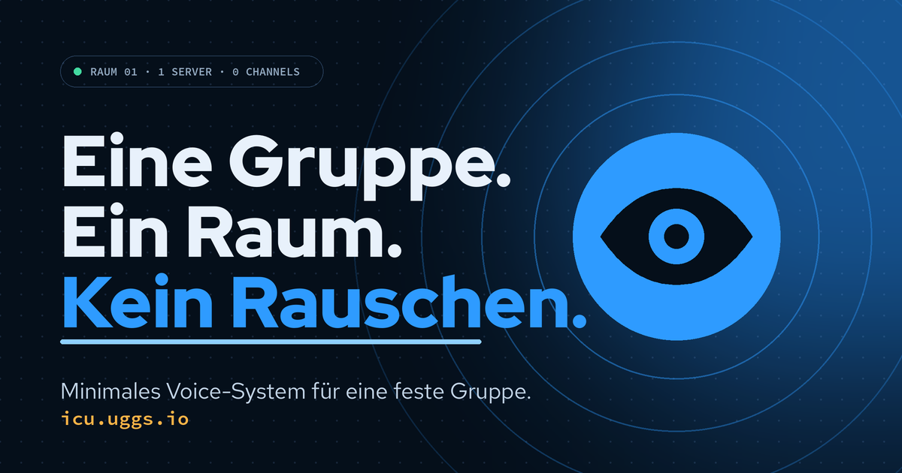
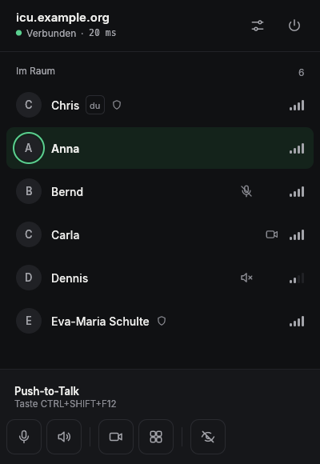
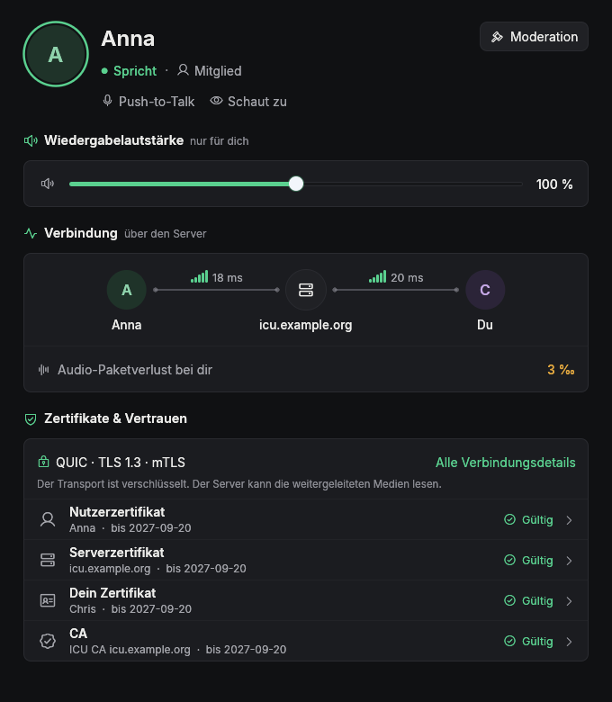
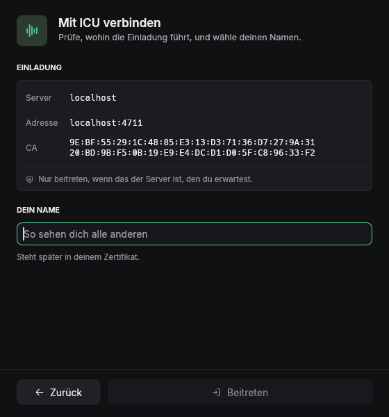
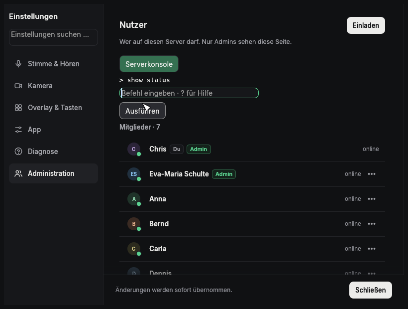
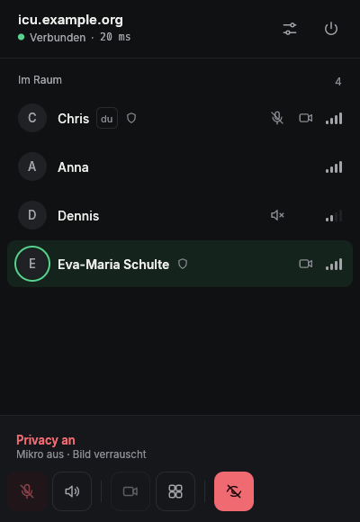
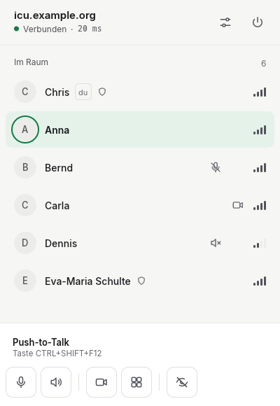

<p align="center">
  <a href="https://icu.uggs.io"></a>
</p>

<p align="center">
  <b>Minimales Voice-System für eine feste Gruppe. Ein Server, ein Raum, keine Channels.</b><br>
  Opus-Sprachqualität, Echo- und Rauschunterdrückung, Kamera-Overlay fürs Spiel und mutual TLS statt Passwort.<br>
  Für Linux und Windows.
</p>

<p align="center">
  <a href="https://github.com/christianreiss/icu/releases/latest"></a>
  <a href="https://github.com/christianreiss/icu/releases"></a>
  
  
  <a href="LICENSE"></a>
</p>

<p align="center">
  <a href="https://github.com/christianreiss/icu/releases/latest"><b>Download</b></a> ·
  <a href="https://icu.uggs.io"><b>Webseite</b></a> ·
  <a href="#loslegen">Loslegen</a> ·
  <a href="#sicherheit">Sicherheit</a> ·
  <a href="docs/README.md">Doku</a> ·
  <a href="README.md">English</a>
</p>

---

ICU ist das, was übrig bleibt, wenn man Mumble und TeamSpeak auf genau eine
feste Gruppe zuschneidet und alles streicht, was diese Gruppe nicht braucht.
Kein Server-Browser, keine Channel-Hierarchie, keine Rollen außer Admin.
Dafür gute Sprache: Opus mit 48 kHz, WebRTC-Echounterdrückung, RNNoise, ein
Jitter-Buffer, der Paketverlust überbrückt, ein Kamera-Overlay über dem Spiel
und ein Zertifikat als Anmeldung.

> Nur die Features, die wirklich gebraucht werden. Die sind dafür perfekt.

Eure Gruppe betreibt ihren eigenen Server: ein statisches Binary, ein UDP-Port.
Wer dazukommt, bekommt eine Einladungsdatei. Niemand tippt ein Passwort,
niemand richtet Channels ein.

## Screenshots

<table>
<tr>
<td width="50%" valign="top">

**Ein Raum, alle drin.** Sprecheranzeige, Signalstärke, Stumm-, Taub- und Kamerastatus je Person; unten Push-to-Talk und die Steuertasten.



</td>
<td width="50%" valign="top">

**Jeder Teilnehmer, ein Klick entfernt.** Eigene Lautstärke für ihn, der Verbindungspfad über deinen Server und die Zertifikate dahinter.



</td>
</tr>
<tr>
<td width="50%" valign="top">

**Einladung statt Passwort.** `.icu`-Datei öffnen oder den Text einfügen, prüfen, wohin sie führt, Namen wählen, fertig.



</td>
<td width="50%" valign="top">

**Admin ohne Webpanel.** Mitglieder, Einladungen, Moderation und eine Serverkonsole direkt im Client.



</td>
</tr>
</table>

<p align="center">
  
  &nbsp;
  
  <br>
  <sub><b>Privacy-Modus</b> mit einem Klick · dunkles und helles Theme</sub>
</p>

## Funktionen

| Bereich | Was ICU macht |
| --- | --- |
| 🎙️ **Audio** | Opus 48 kHz mono in 20-ms-Frames, adaptiver Jitter-Buffer mit FEC/PLC, WebRTC-AEC3-Echounterdrückung, RNNoise-Rauschunterdrückung, automatische Mikrofon- und Empfangslautstärke |
| 🗣️ **Sprechen** | Push-to-Talk oder Voice-Activation, global bindbar inklusive Maustasten (Windows Raw Input, Linux Portal/evdev), Release-Delay, Sende-Cue, Filter gegen Tastaturklicks bei Voice-Activation |
| 👥 **Teilnehmer** | Sprecheranzeige, Stumm-/Taub- und Kamerastatus, Lautstärke pro Person von 0 bis 200 %, dauerhaft gespeichert |
| 📷 **Kamera & Overlay** | H.264-Kamera mit Vorschau; das Overlay ist ein eigenes transparentes Fenster immer im Vordergrund über randlosen Spielen, click-through, GPU-gerendert, DPI-skaliert |
| 🛡️ **Privacy-Modus** | Ein Knopf sperrt das Mikrofon und ersetzt die Kamera durch TV-Rauschen, ohne andere Einstellungen anzufassen |
| 🔑 **Identität** | Mutual TLS mit server-eigener CA; Beitritt per einmaliger, befristeter Einladung; die ganze Identität als Passport exportieren und auf ein anderes Gerät mitnehmen |
| 🧑‍✈️ **Admin** | Einladen, befördern, sperren, stumm- und taubschalten, rauswerfen: im Client, per Server-CLI oder in der interaktiven Admin-Shell |
| ⚙️ **Betrieb** | Ein statisches Server-Binary, automatischer Reconnect mit Backoff, Tray-Icon, Einrichtungsassistent beim ersten Start, signierte Selbst-Updates unter Windows, Nur-Lese-Diagnose `icu-server doctor` |

Die vollständige, mit Zahlen belegte Liste, einschließlich bewusst abgelehnter
Features: [`docs/reference/features.md`](docs/reference/features.md).

### Was fehlt, ist Absicht

- Channels, Server-Browser, Rechteverwaltung außer Admin
- Text-Chat, Dateitransfer, Bots, Plugins
- Overlay in exklusivem Vollbild (dafür bräuchte es DirectX-/Vulkan-Hooking)
- Mobile Clients, Web-Client

Wer eines davon braucht, ist mit Mumble oder TeamSpeak besser bedient, und das
ist in Ordnung.

## Download

Jedes Release enthält dieselben Pakete wie [icu.uggs.io](https://icu.uggs.io),
dazu `SHA256SUMS`, deren Signatur und je Build eine `BUILDINFO`.

| Du nutzt | Paket |
| --- | --- |
| **Windows 10/11** | `icu-<version>-windows-x86_64-setup.exe` (Installation für alle Benutzer, braucht Administratorrechte) oder das portable `icu-<version>-windows-x86_64.zip` |
| **Fedora 42 / 43** | `icu-client-<version>-1.fc42.x86_64.rpm` / `.fc43.x86_64.rpm` |
| **Debian 13** | `icu_<version>-1+deb13_amd64.deb` |
| **Server unter Fedora, AlmaLinux 10+** | `icu-server-<version>-1.x86_64.rpm` |
| **Server unter Debian 12+** | `icu-server_<version>-1_amd64.deb` |

**[→ Aktuelles Release](https://github.com/christianreiss/icu/releases/latest)** ·
ältere Versionen im [Release-Archiv](https://icu.uggs.io/icu/)

Die Windows-Builds sind noch nicht signiert. Beim ersten Start fragt
SmartScreen: „Weitere Informationen“ → „Trotzdem ausführen“. Wo Smart App
Control eingeschaltet ist, blockiert Windows unsignierte Programme.

<details>
<summary><b>Download prüfen</b></summary>

```sh
sha256sum -c --ignore-missing SHA256SUMS
ssh-keygen -Y verify -f packaging/allowed_signers -I icu-release -n icu-release \
  -s SHA256SUMS.sig < SHA256SUMS
```

`packaging/allowed_signers` liegt in diesem Repository. Unter Windows:
`certutil -hashfile icu-<version>-windows-x86_64.zip SHA256`.

</details>

## Loslegen

**1. Server aufsetzen.** Ein Paket, ein Setup-Dialog, ein UDP-Port (Vorgabe 4711).

```sh
sudo dnf install ./icu-server-<version>-1.x86_64.rpm      # Fedora, AlmaLinux 10+
sudo apt install ./icu-server_<version>-1_amd64.deb       # Debian 12+
sudo icu-server setup
sudo systemctl enable --now icu-server
sudo firewall-cmd --permanent --add-service=icu && sudo firewall-cmd --reload
```

**2. Einladungen ausstellen.** Wer sich als Erstes registriert, wird Admin.
Jede Einladung gilt einmal und läuft ab.

```sh
sudo icu-server invite --out /root/icu-admin.icu
icu-server invite --ttl 24h --out ~/bob.icu
```

**3. Client installieren, beitreten.** Einladung öffnen (oder ins Fenster
ziehen), Namen wählen, „Beitreten“. Der Assistent richtet Mikrofon,
Sprechtaste und Klang ein.

```sh
sudo dnf install ./icu-client-<version>-1.fc$(rpm -E %fedora).x86_64.rpm   # Fedora
sudo apt install ./icu_<version>-1+deb13_amd64.deb                         # Debian 13
```

Betriebshandbuch: [`deploy/README.md`](deploy/README.md). Server-Referenz,
Admin-Shell (`icu-server shell`, kurz `icu-cli`) und Diagnose
(`icu-server doctor`): [`docs/reference/server.md`](docs/reference/server.md).

## Sicherheit

- **Eigene CA, kein Passwort.** Jeder Server betreibt seine eigene CA. Die
  Einladung trägt den Vertrauensanker und ein einmaliges
  Registrierungszertifikat; danach ist das Client-Zertifikat deine Anmeldung.
- **Ein stummer Port.** Audio läuft als QUIC-Datagramme über TLS 1.3. Jedes
  Datagramm trägt ein HMAC-Tag mit dem Com-Schlüssel des Servers, nach dem
  Vorbild von OpenVPN `tls-auth` (ohne dessen Replay-Schutz). Ohne den
  Schlüssel antwortet der Port nicht.
- **Ehrlich zum Relay.** Beide Strecken sind verschlüsselt, aber der Server
  leitet weiter und kann die Medien lesen. Deshalb betreibt ihn eure Gruppe
  selbst. ICU ist nicht Ende-zu-Ende-verschlüsselt.
- **Signierte Releases und Updates.** `SHA256SUMS` und der Update-Feed sind mit
  Ed25519 signiert. Der Windows-Client prüft die Signatur, bevor er sich
  aktualisiert.

Wire-Protokoll: [`docs/reference/protocol.md`](docs/reference/protocol.md).

## Selbst bauen

```sh
./build.sh              # Server, Linux-/Windows-Client, alle Pakete, mit Tests
./build.sh --bump       # vorher die gemeinsame Patch-Version erhöhen
./build.sh --clean      # vorher alle kompilierten Ziele entfernen
./build.sh --clean-only # nur Build-Speicher freigeben
```

`./build.sh` baut den Server (statisch, musl), den Linux-Client für Fedora und
Debian in Containern und den Windows-Client per Cross-Compile samt
NSIS-Installer. Dazu laufen Workspace-Tests, Lizenz- und
Supply-Chain-Prüfungen und Paket-Smoke-Tests; alles landet in
`dist/<version>/`. Voraussetzungen: Linux x86-64, Bash, Python ab 3.11, Git,
Podman; die vollständige Liste steht in der
[Bauanleitung](docs/development/building.md).

**Stack** (belegt in `docs/research/`, verifiziert in
`docs/history/verification.md`): Rust · QUIC (quinn + rustls/ring) mit
Datagrams für Audio · Opus 48 kHz mono 20 ms · Server als reiner Relay ·
WebRTC AEC3 · RNNoise · PipeWire (Linux) bzw. WASAPI IAudioClient3 (Windows) ·
egui · Portal/evdev bzw. Raw-Input-Hotkeys · Layer-Shell bzw.
Layered-Window-Overlay · H.264 über OpenH264.

| Pfad | Inhalt |
| --- | --- |
| `crates/` | Rust-Workspace: Protokoll, Server und Client |
| [`docs/`](docs/README.md) | Referenz, Bauanleitung, Tests, Recherche und Verlauf |
| `packaging/` | Paketbau, Cross-Toolchain und Release-Skripte |
| [`web/`](web/README.md) | Webseite icu.uggs.io und Release-Archiv |
| [`deploy/`](deploy/README.md) | Deployment-Dateien und Betriebshandbuch |
| [`experiments/`](experiments/README.md) | Eigenständige Forschungsprogramme |
| `target/` | Regenerierbare Build-Ausgaben und Paket-Staging |
| `dist/<version>/` | Fertige Pakete, BUILDINFO und Prüfsummen |
| `.local/` | Lokale Testumgebungen und aufbewahrte Belege |

[Bauen](docs/development/building.md) · [Client](docs/reference/client.md) ·
[Server](docs/reference/server.md) · [Wire-Protokoll](docs/reference/protocol.md) ·
[Features](docs/reference/features.md)

## Status

Server, Protokoll und Linux-/Windows-Client sind implementiert. Datierten
[Prüfberichten](docs/history/README.md) stehen die offenen
[Live-Test-Aufgaben](docs/development/testing.md) gegenüber; ein früherer
Gate-Lauf ist keine Freigabe des aktuellen Builds. Referenzdokumente
beschreiben das Verhalten, Prüfberichte nennen den jeweils geprüften Stand.

Offen: Windows auf physischer Zielhardware (akustische AEC/Drift,
Gaming-Maus/Spiel-Overlay, gemischte DPI; SmartScreen ist auf Windows 11
geprüft, Smart App Control blockiert, wo eingeschaltet, die unsignierte Exe),
interaktiver Portal-Hotkey-Test auf KDE, Kamera-Bitrate bei echten 15 fps und
an YUYV-Kameras, zwei Rechner über WLAN/WAN mit ratenbegrenztem
Video-Zuschauer; was der Live-Test noch nicht abdeckt, steht in
`docs/development/testing.md` §6.

## Lizenz

Apache-2.0, siehe [`LICENSE`](LICENSE). Die Pakete enthalten
`THIRD-PARTY-LICENSES` für gebündelten Fremdcode. Der Client baut OpenH264 aus
dem Quellcode ein; die Patentlizenz, die Cisco für seine eigenen Binaries
übernimmt, gilt dafür nicht ([H.264-Patentlage](docs/research/packaging-licensing.md)).
