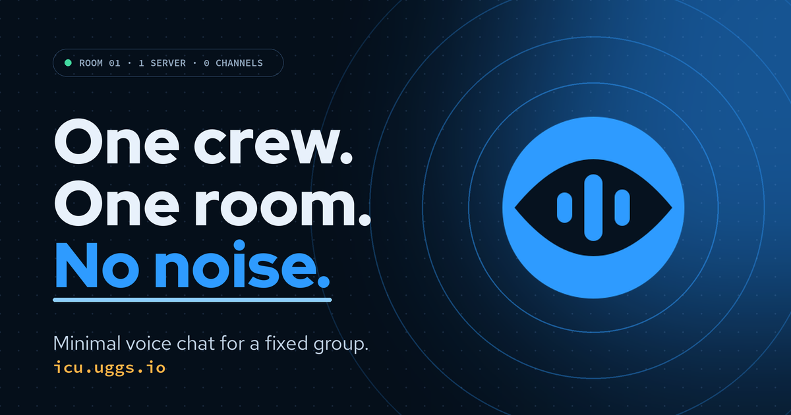
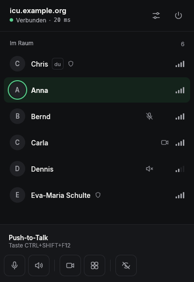
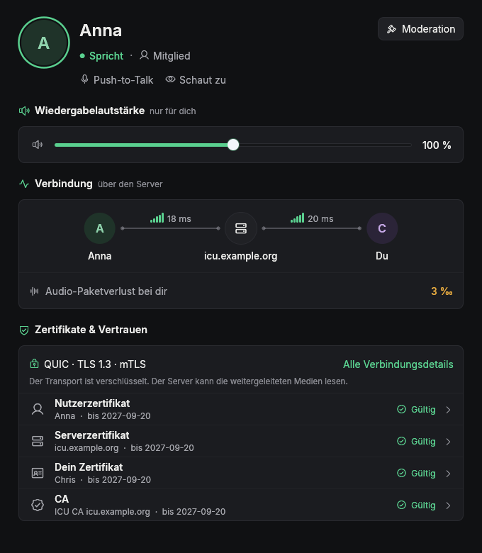
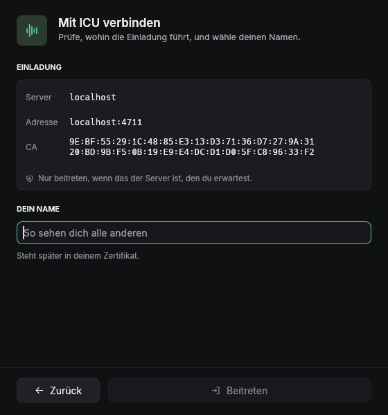
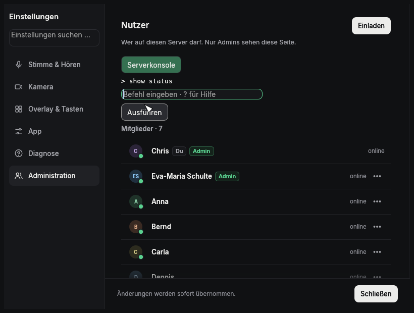
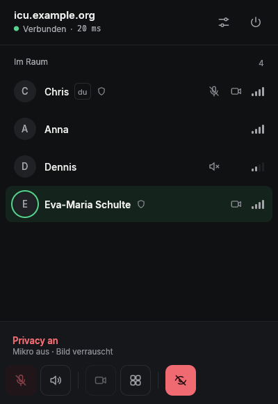
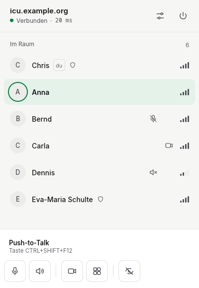

<p align="center">
  <a href="https://icu.uggs.io"></a>
</p>

<p align="center">
  <b>Self-hosted voice chat for a fixed group. One server, one room, no channels.</b><br>
  Opus voice, echo and noise suppression, an in-game camera overlay and mutual TLS instead of passwords.<br>
  For Linux and Windows.
</p>

<p align="center">
  <a href="https://github.com/christianreiss/icu/releases/latest"></a>
  <a href="https://github.com/christianreiss/icu/releases"></a>
  
  
  <a href="LICENSE"></a>
</p>

<p align="center">
  <a href="https://github.com/christianreiss/icu/releases/latest"><b>Download</b></a> ·
  <a href="https://icu.uggs.io"><b>Website</b></a> ·
  <a href="#quick-start">Quick start</a> ·
  <a href="#security-model">Security</a> ·
  <a href="docs/README.md">Docs</a> ·
  <a href="README.de.md">Deutsch</a>
</p>

---

ICU is what is left of Mumble and TeamSpeak once you strip out everything a
fixed group does not need. There is no server browser, no channel tree and no
role system beyond admin. What you get instead is good voice: Opus at 48 kHz,
WebRTC echo cancellation, RNNoise, a jitter buffer that hides packet loss, a
camera overlay that sits on top of your game, and a certificate as your login.

> Only the features that are really needed. Perfected for that.

Your group runs its own server: one static binary, one UDP port. Friends join
with an invitation file. Nobody types a password, and nobody configures
channels.

## Screenshots

<table>
<tr>
<td width="50%" valign="top">

**One room, everybody in it.** Speaking indicator, signal strength, mute, deafen and camera status per person; push-to-talk and the controls at the bottom.



</td>
<td width="50%" valign="top">

**Every participant, one click away.** Your own volume for them, the connection path through your server, and the certificates behind it.



</td>
</tr>
<tr>
<td width="50%" valign="top">

**An invitation instead of a password.** Open the `.icu` file or paste its text, check where it leads, pick a name, done.



</td>
<td width="50%" valign="top">

**Admin without a web panel.** Members, invitations, moderation and a server console, right in the client.



</td>
</tr>
</table>

<p align="center">
  
  &nbsp;
  
  <br>
  <sub><b>Privacy mode</b> with one click · dark and light theme</sub>
</p>

## Features

| Area | What ICU does |
| --- | --- |
| 🎙️ **Audio** | Opus 48 kHz mono in 20 ms frames, adaptive jitter buffer with FEC and PLC, WebRTC AEC3 echo cancellation, RNNoise noise suppression, automatic microphone and playback levels |
| 🗣️ **Talking** | Push-to-talk or voice activation, globally bindable including mouse buttons (Windows Raw Input, Linux portal/evdev), release delay, transmit cue, keyboard-click filter for voice activation |
| 👥 **Participants** | Speaking indicator, mute/deafen and camera status, per-person volume from 0 to 200 % that is remembered |
| 📷 **Camera & overlay** | H.264 camera with preview; the overlay is its own transparent always-on-top window above borderless games, click-through, GPU-rendered, DPI-aware |
| 🛡️ **Privacy mode** | One button stops your microphone and replaces your camera with TV static, without touching your other settings |
| 🔑 **Identity** | Mutual TLS with a CA that belongs to your server; join with a single-use, time-limited invitation; export your whole identity as a passport and move it to another device |
| 🧑‍✈️ **Admin** | Invite, promote, ban, mute, deafen and kick from the client, from the server CLI or from an interactive admin shell |
| ⚙️ **Operations** | One static server binary, automatic reconnect with backoff, tray icon, setup assistant on first launch, signed self-updates on Windows, a read-only `icu-server doctor` |

The complete list, with numbers and with the features that were turned down on
purpose, is in [`docs/reference/features.md`](docs/reference/features.md).

### What is missing is deliberate

- Channels, server browser, permission management beyond admin
- Text chat, file transfer, bots, plugins
- Overlay in exclusive fullscreen (that would need DirectX/Vulkan hooking)
- Mobile and web clients

If you need one of these, Mumble or TeamSpeak is the better choice, and that
is fine.

## Download

Every release ships the same packages that [icu.uggs.io](https://icu.uggs.io)
serves, plus `SHA256SUMS`, its signature and one `BUILDINFO` per build.

| You run | Get |
| --- | --- |
| **Windows 10/11** | `icu-<version>-windows-x86_64-setup.exe` (installs for all users, needs admin rights) or the portable `icu-<version>-windows-x86_64.zip` |
| **Fedora 42 / 43** | `icu-client-<version>-1.fc42.x86_64.rpm` / `.fc43.x86_64.rpm` |
| **Debian 13** | `icu_<version>-1+deb13_amd64.deb` |
| **Server on Fedora, AlmaLinux 10+** | `icu-server-<version>-1.x86_64.rpm` |
| **Server on Debian 12+** | `icu-server_<version>-1_amd64.deb` |

**[→ Latest release](https://github.com/christianreiss/icu/releases/latest)**

The Windows builds are not code-signed yet. On first launch SmartScreen asks:
choose “More info” → “Run anyway”. Where Smart App Control is switched on,
Windows blocks unsigned programs.

<details>
<summary><b>Verify your download</b></summary>

```sh
sha256sum -c --ignore-missing SHA256SUMS
ssh-keygen -Y verify -f packaging/allowed_signers -I icu-release -n icu-release \
  -s SHA256SUMS.sig < SHA256SUMS
```

`packaging/allowed_signers` is in this repository. On Windows:
`certutil -hashfile icu-<version>-windows-x86_64.zip SHA256`.

</details>

## Quick start

**1. Set up the server.** One package, one setup dialog, one UDP port (4711 by default).

```sh
sudo dnf install ./icu-server-<version>-1.x86_64.rpm      # Fedora, AlmaLinux 10+
sudo apt install ./icu-server_<version>-1_amd64.deb       # Debian 12+
sudo icu-server setup
sudo systemctl enable --now icu-server
sudo firewall-cmd --permanent --add-service=icu && sudo firewall-cmd --reload
```

**2. Issue invitations.** Whoever registers first becomes admin. Every
invitation works once and expires.

```sh
sudo icu-server invite --out /root/icu-admin.icu
icu-server invite --ttl 24h --out ~/bob.icu
```

**3. Install the client and join.** Open the invitation (or drag it into the
window), pick a name, press “Join”. The assistant sets up microphone, talk key
and sound.

```sh
sudo dnf install ./icu-client-<version>-1.fc$(rpm -E %fedora).x86_64.rpm   # Fedora
sudo apt install ./icu_<version>-1+deb13_amd64.deb                         # Debian 13
```

Operations manual: [`deploy/README.md`](deploy/README.md). Server reference,
admin shell (`icu-server shell`) and diagnostics (`icu-server doctor`):
[`docs/reference/server.md`](docs/reference/server.md).

## Security model

- **Your own CA, no passwords.** Every server runs its own certificate
  authority. The invitation carries the trust anchor and a single-use
  registration certificate; after that, your client certificate is your login.
- **A silent port.** Audio travels as QUIC datagrams over TLS 1.3, and every
  datagram carries an HMAC tag with the server's com key, in the spirit of
  OpenVPN `tls-auth` (without its replay protection). Without the key the
  port does not answer.
- **Honest about the relay.** Both legs are encrypted, but the server relays
  and can read the media it forwards. That is why your group runs it itself.
  ICU is not end-to-end encrypted.
- **Signed releases and updates.** `SHA256SUMS` and the update feed are signed
  with Ed25519. The Windows client verifies the signature before it updates
  itself.

Wire protocol: [`docs/reference/protocol.md`](docs/reference/protocol.md).

## Build from source

```sh
./build.sh            # server, Linux and Windows clients, all packages, with tests
./build.sh --bump     # raise the shared patch version first
```

`./build.sh` builds the server (static musl), the Linux client for Fedora and
Debian in containers, and the Windows client cross-compiled with its NSIS
installer. It runs the workspace tests, license and supply-chain checks and
package smoke tests, and writes everything to `dist/<version>/`. It needs a
Linux x86-64 host with Bash, Python 3.11+, Git and Podman; the full list is in
the [build guide](docs/development/building.md).

**Stack:** Rust · QUIC ([quinn](https://github.com/quinn-rs/quinn) +
rustls/ring) with datagrams for audio · Opus · WebRTC AEC3 · RNNoise ·
PipeWire on Linux, WASAPI on Windows · [egui](https://github.com/emilk/egui) ·
H.264 via OpenH264 · Wayland layer-shell and Windows layered-window overlay.

| Path | Contents |
| --- | --- |
| `crates/` | Rust workspace: protocol, server and client |
| [`docs/`](docs/README.md) | Reference, build guide, tests, research and history |
| `packaging/` | Package recipes, cross toolchain and release scripts |
| [`web/`](web/README.md) | The website icu.uggs.io and its release archive |
| [`deploy/`](deploy/README.md) | Deployment files and operations manual |
| [`experiments/`](experiments/README.md) | Standalone research programs |

## Status

ICU is young and in use by the group it was built for. Server,
protocol and both clients are complete. The client interface and most of the
documentation are in German for now. Still open: testing on more physical
Windows hardware (acoustic echo, gaming mice, mixed DPI), the portal hotkey on
KDE, and camera bitrate on more webcams. What the live tests do not cover yet
is listed in [`docs/development/testing.md`](docs/development/testing.md).

## License

Apache-2.0, see [`LICENSE`](LICENSE). The packages include
`THIRD-PARTY-LICENSES` for bundled third-party code. The client compiles
OpenH264 from source; Cisco's patent license covers only Cisco's own binaries,
not this build ([details](docs/research/packaging-licensing.md)).
