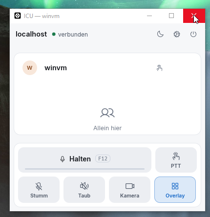
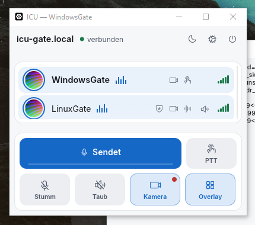
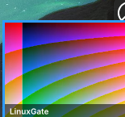
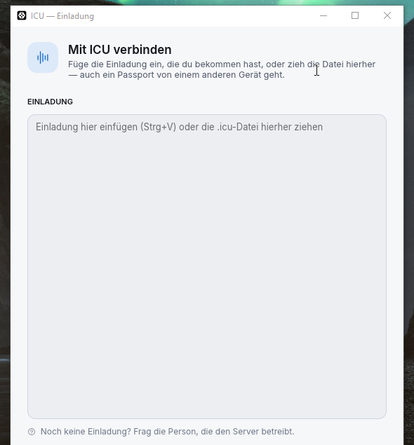
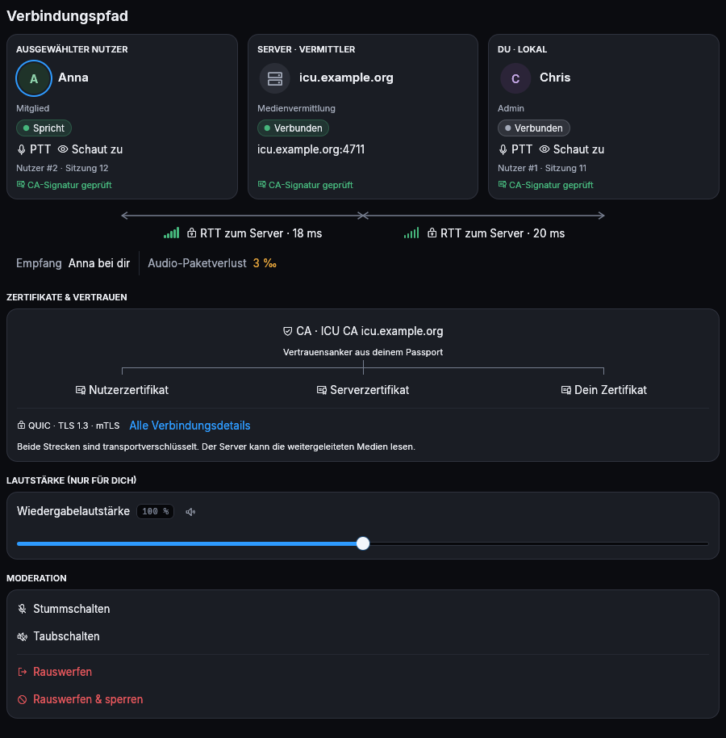
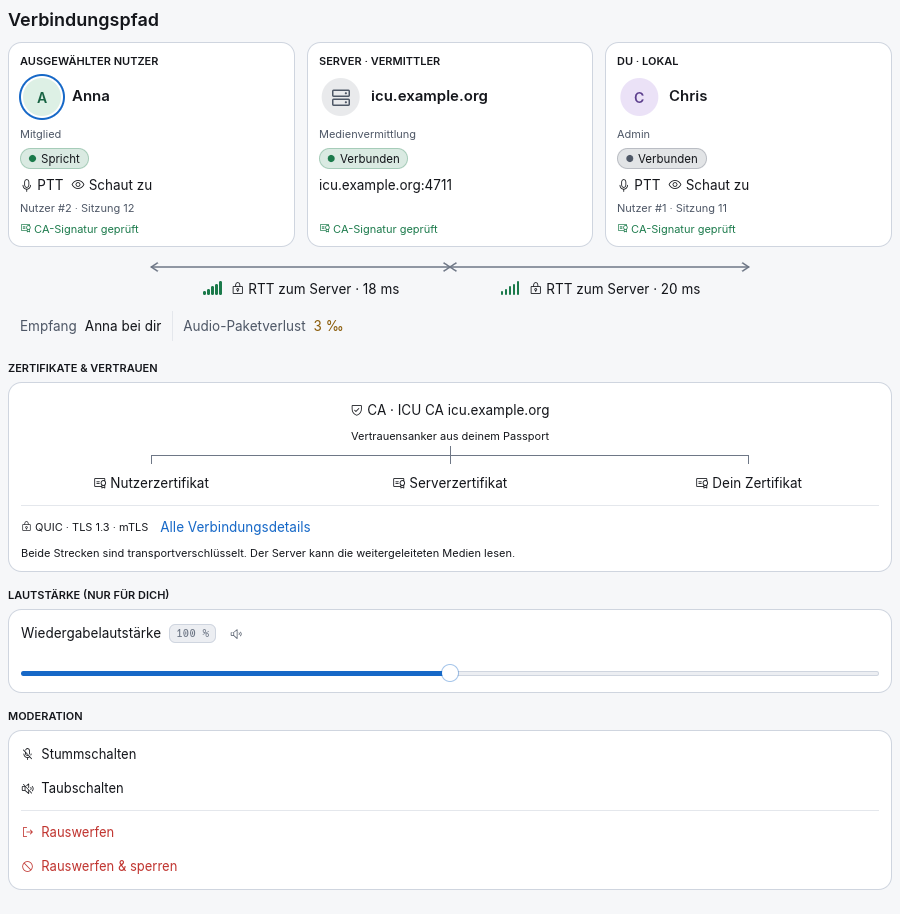

# ICU

**Minimales Voice-System für eine feste Gruppe. Ein Server, ein Raum, keine Channels.**

---

ICU ist das, was übrig bleibt, wenn man Mumble und TeamSpeak auf genau eine
feste Gruppe zuschneidet und alles streicht, was diese Gruppe nicht braucht.
Kein Server-Browser, keine Channel-Hierarchie, keine Rollen außer Admin —
dafür Opus-Sprachqualität, WebRTC-AEC, RNNoise, ein Kamera-Overlay fürs
Spiel und mutual TLS statt Passwort.

> Nur die Features, die wirklich gebraucht werden. Die sind dafür perfekt.

## Screenshots

<table>
<tr>
<td width="50%">

**Hauptfenster** — ein Raum, alle Teilnehmer, PTT und Overlay auf einen Blick

</td>
<td width="50%">

**Videocall mit Kamerakacheln** — Sprecher-Indikator, Signalstärke, RTT je Teilnehmer

</td>
</tr>
<tr>
<td width="50%">

**In-Game-Overlay** — click-through, always-on-top, zeigt Kamera und Sprecher-Highlight über einem Borderless-Fenster-Spiel

</td>
<td width="50%">

**Einladung statt Passwort** — `.icu`-Datei oder Text einfügen, fertig registriert

</td>
</tr>
</table>

**Verbindungspfad & Zertifikate** — wer mit wem spricht, worüber, und mit welchem CA-Vertrauensanker, auf einen Blick:

&nbsp;&nbsp;

## Features

| Bereich | Was ICU macht |
| --- | --- |
| **Audio** | Opus 48 kHz mono, adaptiver Jitter-Buffer mit FEC/PLC, WebRTC-AEC3-Echounterdrückung, RNNoise-Rauschunterdrückung, automatische Mikrofon- und Empfangslautstärke |
| **Sprechen** | Push-to-Talk oder Voice-Activation, global bindbar inkl. Maustasten (Windows Raw Input, Linux Portal/evdev), Release-Delay, Sende-Cue |
| **Teilnehmer** | Liste mit Speaking-Indicator, Mute/Deafen-Status, Kamera-Status, Lautstärke pro Person (0–200 %, persistent) |
| **Kamera & Overlay** | Kamera an/aus mit Vorschau; Overlay als eigenes transparentes Always-on-top-Fenster über Borderless-Spielen, click-through, GPU-gerendert mit DPI-skalierter Sprecher-Hervorhebung — kein Render-Hooking |
| **Identität & Zugang** | Mutual TLS mit server-eigener CA; Beitritt per Einladungs-Bundle (`.icu`-Datei oder Text), kein Passwort; eigenes Zertifikat sichtbar, Passport zum Exportieren/Importieren der ganzen Identität |
| **Admin** | Einladen, befördern/entziehen, sperren/entsperren, entfernen, stumm-/taubschalten, rauswerfen — im Client und per Server-CLI/Shell |
| **Betrieb** | Automatischer Reconnect mit Backoff, ein statisches Server-Binary, Tray-Icon, minimaler Settings-Dialog, Einrichtungsassistent beim ersten Start |

Vollständige, mit Zahlen belegte Liste inklusive bewusst abgelehnter Features:
[`docs/reference/features.md`](docs/reference/features.md).

## Nicht-Ziele

- Channels, Rechteverwaltung, Rollen außer Admin, Server-Browser
- Text-Chat, Dateitransfer, Bots, Plugins
- Overlay in exklusivem Fullscreen (DirectX/Vulkan-Hooking)
- Mobile Clients, Web-Client

## Installation

Überblick und Downloads: https://icu.uggs.io (Quelle: [`web/`](web/README.md)).
Pakete unter https://github.com/christianreiss/icu/releases: der Client `icu`
für Fedora 42/43 (`.rpm`) und Debian 13 (`.deb`) sowie als portables, unsigniertes
ZIP für Windows 10/11 (SmartScreen beim ersten Start: „Weitere Informationen“ →
„Trotzdem ausführen“) oder, alternativ, ein ebenfalls unsigniertes Setup pro
Benutzer (Startmenü-Eintrag, Deinstallation über Einstellungen/Systemsteuerung,
keine Administratorrechte; SmartScreen warnt bei beiden gleich), der Server `icu-server` für
Fedora, AlmaLinux 10+ (`.rpm`) und Debian 12+ (`.deb`) (Einrichtung:
`deploy/README.md` §0), sowie eine interaktive Admin-Shell
(`icu-server shell`, kurz `icu-cli`, [Server-Referenz](docs/reference/server.md#51-shell)) und
eine Nur-Lese-Diagnose für Konfiguration, State, Zertifikate und Ports
(`icu-server doctor`, §5).

## Entwicklung und Dokumentation

`./build.sh` baut den aktuellen Code: Server, Linux-/Windows-Client, alle
DEB-/RPM-Pakete und den Windows-Installer, mit Live-Dashboard und Prüfungen.
Mit `./build.sh --bump` wird vorher die gemeinsame Patch-Version erhöht.
`./build.sh --clean` entfernt vorher alle kompilierten Ziele und baut frisch;
beide Optionen lassen sich kombinieren.
Details und Voraussetzungen: [Bauanleitung](docs/development/building.md).

| Pfad | Inhalt |
| --- | --- |
| `crates/` | Rust-Workspace: Protokoll, Server und Client |
| [docs/](docs/README.md) | Referenz, Bauanleitung, Tests, Recherche und Verlauf |
| [experiments/](experiments/README.md) | Eigenständige Forschungsprogramme |
| `packaging/` | Paketbau, Cross-Toolchain und Release-Skripte |
| [web/](web/README.md) | Webseite icu.uggs.io: Überblick, Screenshots, Download |
| [deploy/](deploy/README.md) | Deployment-Dateien und Betriebshandbuch |
| `target/` | Regenerierbare Build-Ausgaben und Paket-Staging |
| `dist/<version>/` | Fertige Pakete, BUILDINFO und Prüfsummen |
| `.local/` | Lokale Testumgebungen und aufbewahrte Belege |

[Bauen](docs/development/building.md) · [Client](docs/reference/client.md) ·
[Server](docs/reference/server.md) · [Wire-Protokoll](docs/reference/protocol.md) ·
[Features](docs/reference/features.md)

## Status

Server, Protokoll und Linux-/Windows-Client sind implementiert. Datierten
[Prüfberichten](docs/history/README.md) stehen die offenen
[Live-Test-Aufgaben](docs/development/testing.md) gegenüber; ein früherer Gate-Lauf
ist keine Freigabe des aktuellen Builds. Referenzdokumente beschreiben das
Verhalten, Prüfberichte nennen den jeweils geprüften Stand.

Stack (belegt in `docs/research/`, verifiziert in `docs/history/verification.md`): Rust; QUIC (quinn + rustls/ring) mit Datagrams für Audio; mutual TLS mit server-eigener CA und Registrierung per Einladungs-Bundle (`.icu`-Datei); Com-Schlüssel je Server nach dem Vorbild von OpenVPN `tls-auth` (ohne dessen Replay-Schutz) (HMAC-Tag auf jedem Datagramm, ohne ihn bleibt der Port stumm); Opus 48 kHz mono 20 ms; Server als reiner Relay; Client mit PipeWire (Linux) bzw. WASAPI IAudioClient3 (Windows), WebRTC AEC3, RNNoise, adaptivem Jitter-Buffer, egui-UI, Portal/evdev bzw. Raw-Input-Hotkeys, Layer-Shell bzw. Layered-Window-Overlay, H.264 über openh264.

Offen: Windows auf physischer Zielhardware (akustische AEC/Drift, Gaming-Maus/Spiel-Overlay, gemischte DPI; SmartScreen ist auf Windows 11 geprüft, Smart App Control blockiert, wo eingeschaltet, die unsignierte Exe), interaktiver Portal-Hotkey-Test auf KDE, Kamera-Bitrate bei echten 15 fps und an YUYV-Kameras, zwei Rechner über WLAN/WAN mit ratenbegrenztem Video-Zuschauer; was der Live-Test noch nicht abdeckt, steht in `docs/development/testing.md` §6.

## Lizenz

Apache-2.0, siehe `LICENSE`. Die Pakete enthalten `THIRD-PARTY-LICENSES` für gebündelten Fremdcode. Der Client baut OpenH264 aus dem Quellcode ein; die Patentlizenz, die Cisco für seine eigenen Binaries übernimmt, gilt dafür nicht (`docs/research/packaging-licensing.md`, H.264-Patentlage).
